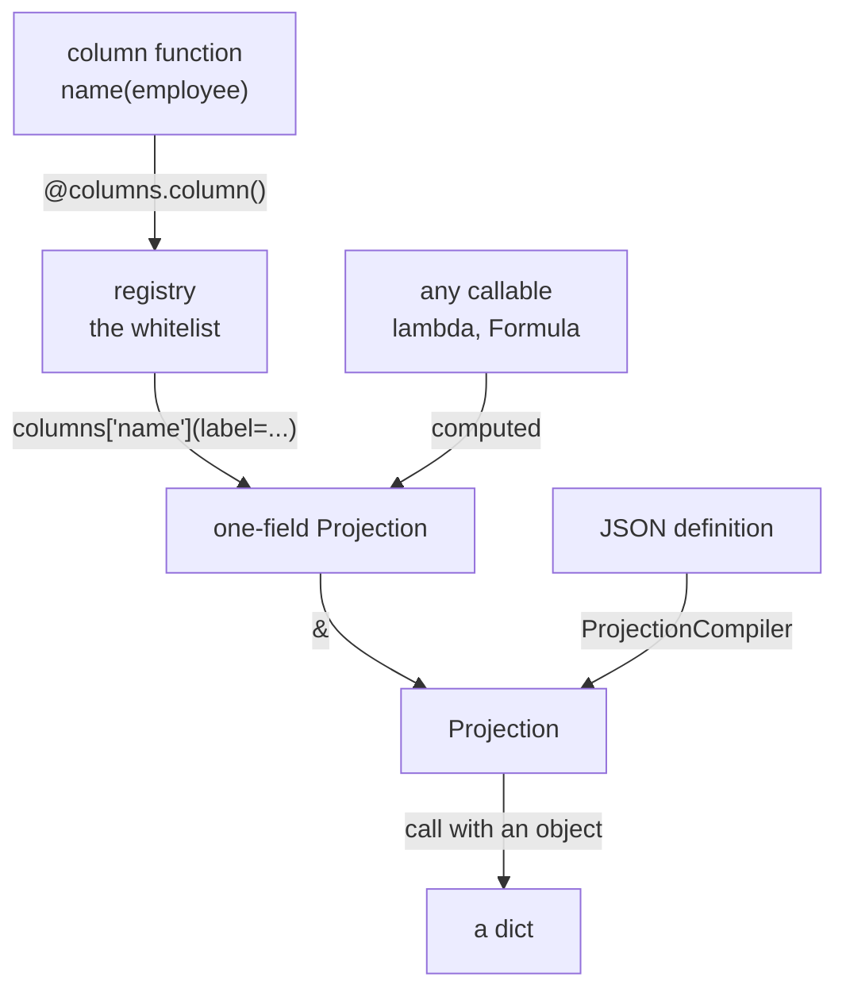

# User guide

pyprojection has a handful of pieces. Each page covers one of them.

| Piece | What it is | Page |
| --- | --- | --- |
| `ProjectionRegistry` | the whitelist: `@columns.column()` turns `fn(subject, ...)` into a column factory | [Columns and registries](columns.md) |
| `Projection`, `computed` | ordered `(output name, callable)` pairs, joined with `&`; derived columns | [Projections and computed columns](projections.md) |
| `ProjectionCompiler` | JSON definitions (or `?fields=`) to projections, errors carry a JSON path | [Compiling projections from JSON](compiling.md) |
| `get_projection_json_schema` | JSON Schema of the definitions a compiler accepts | [JSON Schema](json-schema.md) |

The examples in the guide build on each other: they start on
[Columns and registries](columns.md) with an `Employee` and a registry of its columns, and
later pages reuse them. A comment directly under a line shows what that line outputs or
raises.

## The mental model

1. You write small **column functions** that read one value from an object. Extra
   parameters become arguments.
2. A **registry** collects them. It is the whitelist: only registered, visible columns can
   be selected by name.
3. Calling a column's **factory** binds its arguments (and an optional `label`) and returns a
   one-field projection. `computed(name, fn)` does the same for any callable.
4. Projections **join** with `&`. Output names must be unique; this is checked when the
   projection is built.
5. Calling a projection with an object returns a **dict**, in field order.

A projection is immutable: `&` returns a new one, so a base projection can be shared and
extended safely.
